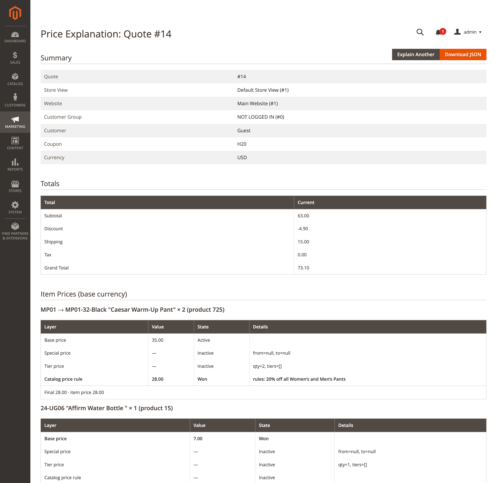
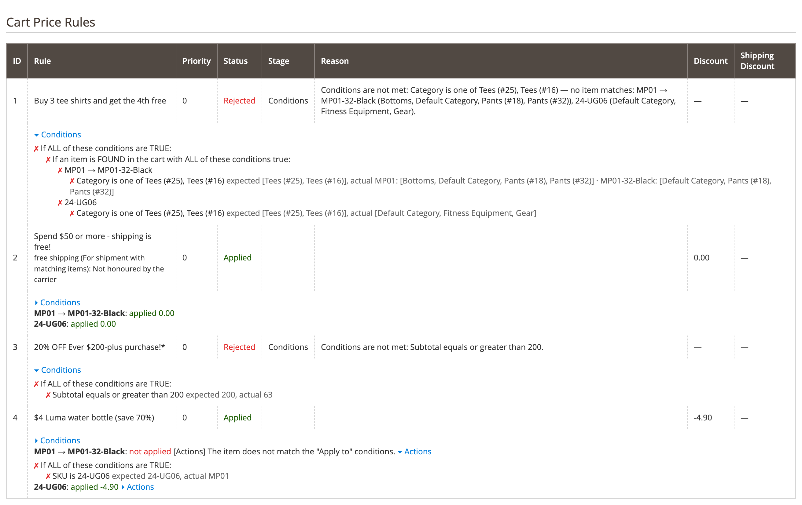
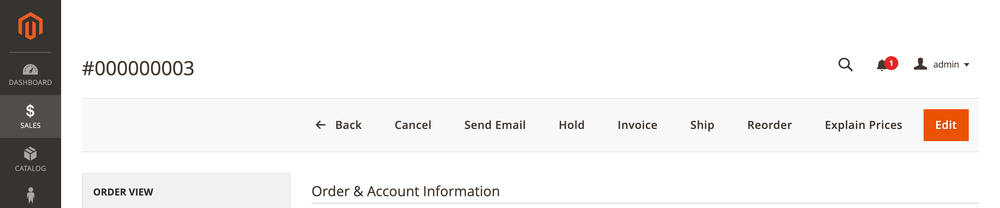

# DmLab_PriceExplain

> Explains why a Magento 2 cart or order costs what it costs — price layers, totals, cart price rules, free shipping and tax.

[](https://github.com/dmlab-work/module-price-explain/actions/workflows/ci.yml) [](https://codecov.io/gh/dmlab-work/module-price-explain) [](https://packagist.org/packages/dmlab/module-price-explain) [](https://packagist.org/packages/dmlab/module-price-explain) [](https://packagist.org/packages/dmlab/module-price-explain) [](LICENSE) 



## The problem
"Why didn't my coupon apply?" "Why is shipping charged when the rule says free?" Magento shows the result, never
the reason. Answering means checking special, tier and catalog rule prices, every cart rule's conditions, stacking
flags, carrier semantics and tax settings by hand — or stepping through `collectTotals()` in a debugger.

## What it explains
One read-only report per quote, or per order via its quote:

- **Totals** — subtotal, discount, shipping, tax, grand total; for an order, side by side with what was placed.
- **Item prices** — base, special (with dates), tier/group, catalog rule (with rule names), custom options, custom
  price; which layer won. A gap to the actual price names the third-party price observers; the price index is
  checked too.
- **Totals collectors** — every collector in `sales.xml` order, core and third-party, with what it changed.
- **Cart price rules** — applied (amount per item) or rejected with the stage and reason: website, group, dates,
  coupon, usage limits, the failing condition with expected vs actual value (category and option names, not IDs),
  "Apply to" actions, discount step, or discarded by an earlier rule. Configurable children fold under the parent
  (`MP01 → MP01-32-Black`).
- **Free shipping** — whether a granted free shipping actually reaches the customer (see below).
- **Tax** — tax classes, the address used, rates per item and shipping, algorithm and flags; "no tax" has a reason.

Numbers come from a real `collectTotals()` on an isolated quote; reasons from an independent evaluator. When the
two disagree (a plugin changed the result), the report says so.

## Install
```bash
composer require dmlab/module-price-explain
bin/magento setup:upgrade
```
Magento 2.4.9+, PHP 8.3–8.5.

## Usage
- **Marketing → Promotions → Explain Prices** — a quote ID or an order number.
- **Sales → Orders → order view** — *Explain Prices* button.
- **Customers → customer → Shopping cart** — *Explain Prices* link per website cart.
- CLI: `bin/magento dmlab:price:explain --quote=42` or `--order=000000123`.

| Rule condition tree | Order view button |
|---|---|
|  |  |

```
#3 20% OFF Ever $200-plus purchase!* (sort 0) — Rejected [Conditions] Conditions are not met: Subtotal equals or greater than 200.
    ✗ Subtotal equals or greater than 200: expected 200, actual 63
#4 $4 Luma water bottle (save 70%) (sort 0) — Applied · discount -4.90
    MP01 → MP01-32-Black: not applied [Actions] The item does not match the "Apply to" conditions.
        ✗ SKU is 24-UG06: expected 24-UG06, actual MP01
    24-UG06: applied -4.90
```

## Reference
| | |
|---|---|
| CLI | `dmlab:price:explain --quote=<id> \| --order=<increment id> [--format=text\|json] [--all-rules] [--all-collectors]`; exit 1 when it can't be explained |
| Admin | *Include rules of other websites*, *Show all collectors*, *Download JSON*; failing condition trees open by default |
| ACL | `DmLab_PriceExplain::explain` (Marketing → Promotions) |
| JSON | `quote`, `order`, `totals`, `items`, `collectors`, `rules`, `free_shipping`, `tax`, `warnings`; every code has a `*_label` next to it |
| Warnings | `price_delta`, `index_mismatch`, `index_missing`, `condition_mismatch`, `rule_mismatch`, `free_shipping_not_effective`, `multishipping`, `area`, `order_current_state`, `order_totals_mismatch`, `order_rules_mismatch` |
| PHP API | `DmLab\PriceExplain\Api\ExplainerInterface` |

### Free shipping
A rule sets an item flag ("For matching items only") or an address flag ("For shipment with matching items");
whether the price drops depends on the carrier. Flat Rate honours item flags only and is free only when all boxes
are; Table Rate counts flagged units; Free Shipping honours the address flag.

| Verdict | Meaning |
|---|---|
| `effective` | the selected method is free |
| `not_honoured_by_carrier` | the carrier ignores the flag the rule sets (e.g. Flat Rate + address mode) |
| `partial` | some boxes are still charged |
| `stale_rate` | the stored rate predates the rule |
| `unknown_carrier` | a third-party carrier charges with the flag set |
| `not_granted` | the rule applied but core set no flag |
| `no_method` | no shipping method or stored rate |

Anything but `effective` (or `no_method` with nothing selected) adds a `free_shipping_not_effective` warning.

### Storefront run
The admin page runs the explanation on the **storefront** of the quote's store, so frontend-only observers and
plugins run as at checkout. The page gets a token and POSTs it to `dmlab_price_explain/report/json`:
HMAC-SHA256 over `crypt/key`, valid 60 s, single use, checked against the store, sent in the body only;
responses are `no-store`. If the call fails, the page falls back to an admin-area run with the `area` warning.

## Safety
Nothing is written: the quote is loaded outside the repository, totals are collected in a transaction that is
always rolled back, stored shipping rates are reused (no carrier calls). Outside an explanation the plugins cost
one flag check.

## Limitations
- Orders are explained with today's rules and prices; differences from the placed order are reported as warnings.
  An order's own coupon use counts, so a single-use coupon shows as used up.
- Orders older than the quote lifetime (`checkout/cart/delete_quote_after`) can't be explained: their quote is gone.
- Multishipping: rules and tax cover the first shipping address only.
- Fixed-price bundles and downloadable links are shown without a layer breakdown.
- Third-party condition types report their result only, without expected/actual values.
- With automatic customer group assignment by VAT ID, core may call VIES during an explanation.

## Tests
Unit: `vendor/bin/phpunit -c Test/Unit/phpunit.xml`. Integration (real fixtures; nothing written, verdicts match
core): [Test/Integration/README.md](Test/Integration/README.md). CI runs both on Magento 2.4.9.

## License
[OSL-3.0](LICENSE)
